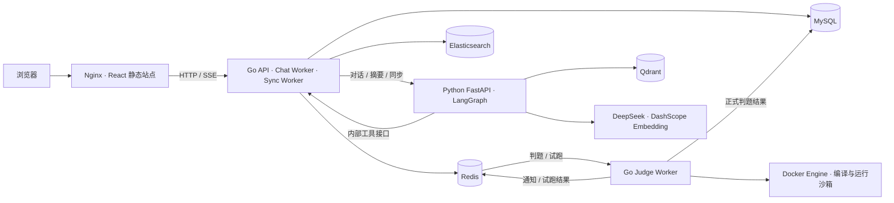
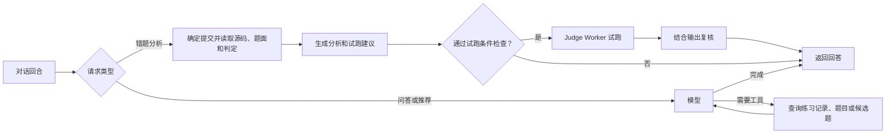

# 系统架构

## 服务与进程

Go API 处理业务请求，在同一进程中运行 Chat Worker、Sync Worker 和实时事件桥接。Judge Worker 是独立进程，也是生产应用中唯一挂载 Docker Socket 的进程。Python Agent 接收 Go 发来的对话、摘要和索引同步任务，并通过 Go 的内部接口读取用户业务数据。

| 存储 | 用途 |
| --- | --- |
| MySQL | 用户、题目、标签、测试用例、提交、会话、消息、回合与反馈的事实数据 |
| Redis | 任务队列、事件发布、Refresh Session、SSE Ticket、限流、缓存和排行榜 |
| Elasticsearch | 使用 IK 分词的题目关键词索引 |
| Qdrant | 题目语义索引与按用户隔离的长期对话记忆 |

## 判题

1. Go API 将提交写入 MySQL，再把异步任务加入 Redis。
2. Judge Worker 领取任务并设置租约。它在编译容器中分别编译 Go 源码和判题 Runner，再为提交创建运行容器。
3. Worker 在同一个运行容器中逐个执行正式测试用例，调用 Runner 采集退出状态、耗时、内存和输出。首个失败用例决定失败判定。
4. Worker 将最终结果写回 MySQL，通过 Redis Pub/Sub 发布判题事件。Go API 用 SSE 推送事件，客户端也可通过提交接口查询结果。

| 判定 | 含义 |
| --- | --- |
| `AC` | 答案正确 |
| `WA` | 输出与预期不符 |
| `CE` | 提交源码编译失败 |
| `RE` | 程序异常退出 |
| `TLE` | 运行超时 |
| `MLE` | 内存超限 |
| `OLE` | 输出超限 |
| `SE` | 判题系统错误 |

编译容器从[判题编译镜像](../Dockerfile.judge-compiler)复制预热的 Go 标准库缓存，副本保存在本次任务独立的 `tmpfs` 中。复制失败时用空缓存继续编译。运行容器使用 `golang:alpine`。两类容器都关闭网络，并限制 CPU、内存与进程数。Runner 还限制运行时间和输出规模。Worker 任务结束后清理容器及临时目录，启动时按环境标签清理异常退出遗留的容器，并在自己的 `TMPDIR` 下清理遗留工作目录。沙箱与 Judge Worker 所在机器共享宿主机内核。

题目页可以直接运行编辑器里的 Go 代码和一组自定义输入。网页任务与 Agent 共用试跑队列和专用执行槽。队列按用户限制同时挂起的网页任务，运行结果短暂保存在 Redis。正式判题的测试用例、提交状态和得分由提交队列维护。

## 学习助手

用户发出消息后，Go API 将消息与回合写入 MySQL，再进入 Chat 队列。Chat Worker 领取回合并调用 Python `/chat/run`。Python 通过统一的 LangGraph 入口选择对话流程。

### 普通问答与推荐

LangChain `create_agent` 构建模型与工具的调用循环。工具可读取用户的通过记录、失败提交、标签统计和候选题。题目推荐可融合 Elasticsearch 词法召回与 Qdrant 语义召回，再对候选题重排。对话窗口和会话摘要提供近期上下文，Qdrant 提供按用户筛选的长期记忆。

### 错题分析与试跑

错题流程先确定用户自己的失败提交，读取原源码、题面和判定。模型给出初步分析，并按需提出一个可用自定义输入验证的猜测。程序校验试跑条件，经 `POST /api/agent/trials` 将任务放入独立 Redis 队列。

Judge Worker 在专用执行槽中重新编译原提交，只运行这组输入。每回合最多试跑一次，输入上限为 4 KiB，排队、编译与执行共用 30 秒。试跑结果供模型复核，正式判定、题目统计和用户积分保持原值。错题流程给模型的分析材料由题面、源码和判定组成，试跑阶段使用模型构造的输入。试跑不可用或超时时，助手返回初步分析并标明猜测尚未验证。

### 执行身份与会话记忆

Go 与 Python 使用 `X-Agent-Service-Token` 鉴权。Python 调用 `/api/agent/*` 时还需携带回合编号和本次执行的 `ProcessingToken`。Go 从正在运行的回合确定数据归属，并检查执行租约和会话状态。提交工具进一步核对归属。回合重领后，由旧执行发出的工具请求和结果写入会被拒绝。服务接口及请求头见 [API 参考](api.md#agent-内部接口)。

Go 在同一 MySQL 事务中保存已确认的回答并标记待同步记忆。Sync Worker 按回合编号读取已持久化内容，调用 Python 写入 Qdrant。向量记录 ID 由用户、回合和记忆类型确定，重试可覆盖同一记录。Go 会扫描待同步回合，补偿入队失败。

## 异步索引与排行榜

题目和标签变更通过 Redis 同步任务更新 Elasticsearch 和 Qdrant。正式判题首次通过后，排行榜同步任务根据 MySQL 中的已解决题数更新 Redis ZSet。索引和排行榜以 MySQL 为准，业务更新到搜索可见之间存在同步延迟。

同步队列支持领取租约、到期恢复、退避重试和死信记录。索引与排行榜由后台任务周期校准，学习助手的待同步记忆由回合标记独立补偿。[队列与执行日志查询](deployment.md#日志与排障)见运维指南。
